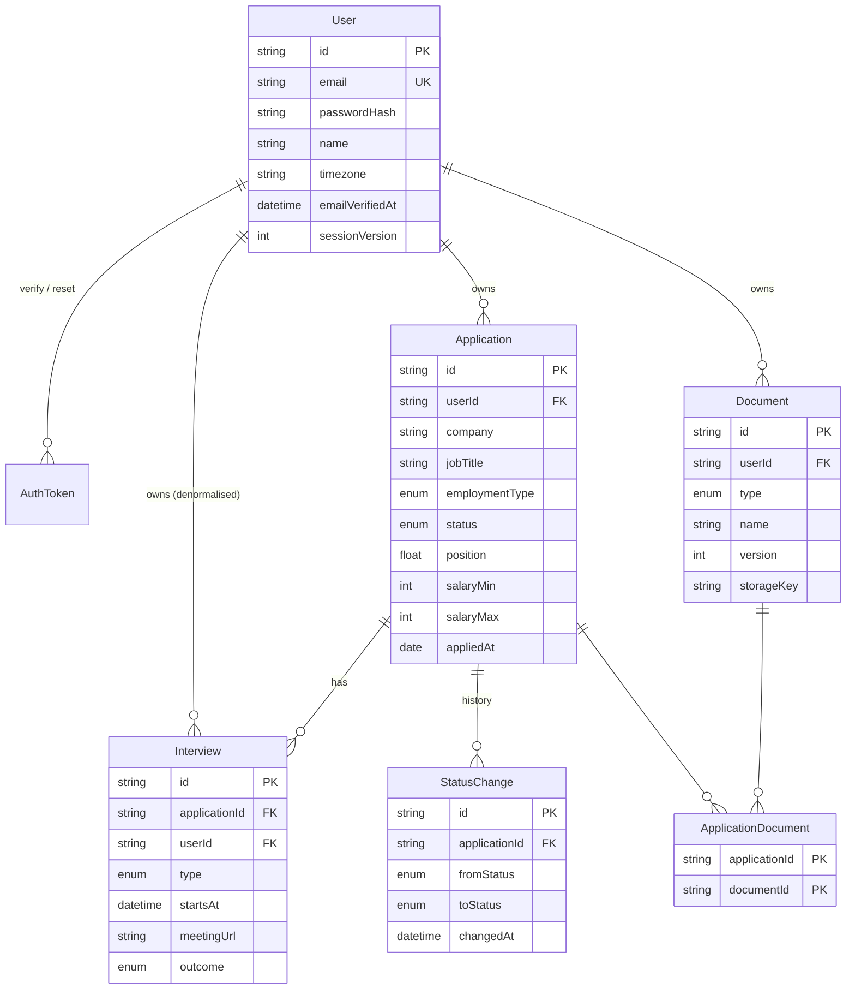

# 02 — Database Schema

Source of truth: [`server/prisma/schema.prisma`](../server/prisma/schema.prisma) (Prisma 7, PostgreSQL).

## Entity Relationship Diagram

## Tables at a Glance

| Table | Purpose | Key notes |
|---|---|---|
| `User` | Account + profile | Email stored lower-case. `emailVerifiedAt` null = unverified. `sessionVersion` is copied into the Auth.js JWT; bumping it invalidates every existing session. |
| `AuthToken` | Email verification, password reset, email change | Single-use (`usedAt`), hashed, expiring. |
| `Application` | A job application | `position` orders cards inside a Kanban column. Salary split into min/max/currency/period so it can be sorted and charted. |
| `StatusChange` | Status audit log | Written in the **same transaction** as every status update (including creation). Drives timeline + analytics. |
| `Interview` | Interview round | `userId` duplicated from the application so "upcoming interviews" is one indexed query. |
| `Document` | Uploaded file metadata | File bytes live in Cloudinary/S3; `storageKey` is private. Versions: same `(type, name)`, incrementing `version`. |
| `ApplicationDocument` | Join table | Which CV / cover letter was sent where. |

## Delete Behaviour

| Deleting… | Effect |
|---|---|
| User | Cascades everything; the API also deletes the user's stored files. |
| Application | Cascades interviews, status changes, join rows. Documents stay. |
| Document | Removes join rows; API deletes the stored file. |

## Kanban Position Strategy

- New card in a column: `position = max(position in column) + 1000`.
- Dropped between cards A and B: `position = (A.position + B.position) / 2`.
- If the gap gets too small (< 0.001), renormalise the column (`1000, 2000, 3000…`) in one transaction. Rare in practice.

## Key Queries & Their Indexes

| Query | Index |
|---|---|
| Kanban board: apps by status ordered | `Application(userId, status, position)` |
| List filtered by date range / sorted by date | `Application(userId, appliedAt)`, `(userId, createdAt)` |
| Search company | `Application(userId, company)`; `ILIKE '%q%'` is fine at personal scale. Upgrade path: `pg_trgm` GIN index. |
| Upcoming interviews | `Interview(userId, startsAt)` |
| Analytics "ever reached status" | `StatusChange(userId, toStatus)` |
